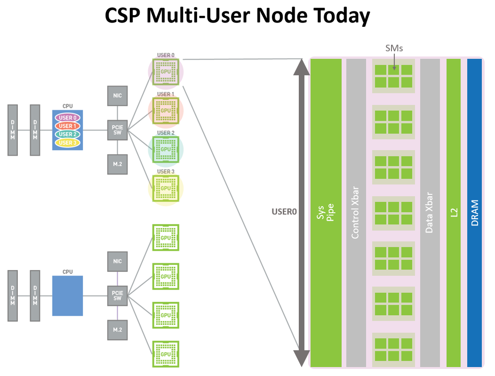
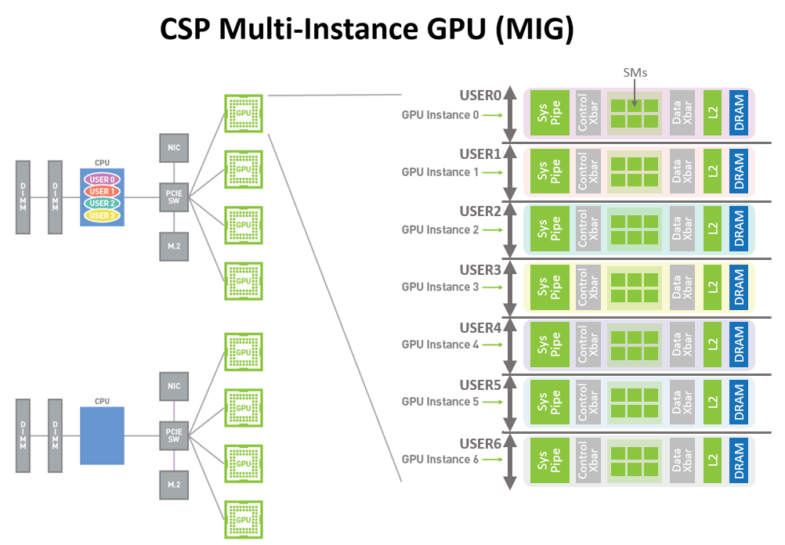
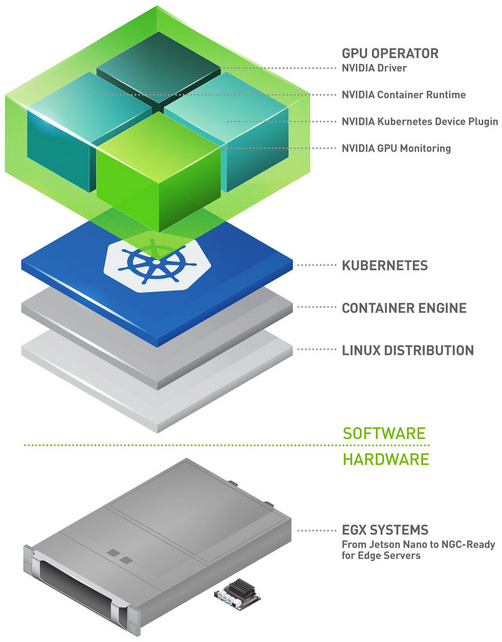

# Module 02 — GPU Resource Management & Virtualization (Chapter 2)

> GPU တစ်လုံးကို ဘယ်လို ခွဲဝေ/မျှဝေ/သီးခြားခွဲ/schedule လုပ်မလဲ —
> MIG, sharing/isolation, vGPU, Kubernetes scheduling ကို အပြည့် ရှင်းပြပါမည်။

---

## 2.0 ဘာကြောင့် GPU resource management လိုသလဲ (Background)

GPU တစ်လုံးက စွမ်းအင် အများကြီး ရှိပြီး workload အများက တစ်လုံးလုံး မလိုပါ —
ဒါကြောင့် **ခွဲဝေ (partition) / မျှဝေ (share) / သီးခြားခွဲ (isolate) / စီစဉ် (schedule)**
လုပ်နိုင်မှ ကုန်ကျစရိတ် ပြန်ရပါမည်။ နည်းလမ်း ၄ မျိုး —

```
MIG (hardware partition) | MPS/time-slicing (software share)
vGPU (hypervisor)        | K8s scheduling (fleet level)
```

## 2.1 MIG Configuration ⭐⭐

### How MIG works

MIG (Multi-Instance GPU) က GPU ကို **hardware-level** တွင် ခွဲပါသည် —
SM, memory, L2 cache, copy engine အားလုံး သီးခြား instance အဖြစ် ကျရောက်ပါသည်။


*sharing without MIG — isolation မရှိ*


*MIG instances — hardware-isolated*

- Ampere+ data center GPU — instance အမြင့်ဆုံး **7 ခု**
- profile ဥပမာ (H100): 1g.10gb / 2g.20gb / 3g.40gb / 7g.80gb
- အားသာချက် — QoS တည်ငြိမ်၊ crash isolation၊ guaranteed memory
- အားနည်းချက် — instance ပြောင်းလျှင် reset လို၊ flexibility နည်း

### Configure & Monitor — Tools Usage ⭐

```bash
sudo nvidia-smi -mig 1                 # MIG mode enable (restart လို) 
nvidia-smi -lgc / -lmc                 # ရရှိနိုင်သော profile စာရင်း
sudo nvidia-smi mig -cgi 9,9 -C        # instance ဖန်တီး
sudo nvidia-smi mig -lgi               # instance စာရင်း ကြည့်
sudo nvidia-smi mig -dgi -gi 0         # instance ဖျက်
nvidia-smi -L                          # MIG instance များ ပြ
```

⚠️ **"enabled ≠ usable"** — mode on ရုံနှင့် workload မထည့်နိုင် — instance ဖန်တီးမှ ရပါမည်။ ⭐

## 2.2 GPU Sharing & Isolation Techniques ⭐

| နည်းလမ်း | ဘယ်လို | isolation | performance |
|---|---|---|---|
| **Time-slicing** | time slot အလိုက် အလှည့်ကျ | မရှိ | ပြောင်းလဲ |
| **MPS** (Multi-Process Service) | process များ တပြိုင်နက် CUDA context မျှဝေ | partial | ကောင်း |
| **MIG** | hardware partition | အပြည့် | တည်ငြိမ် |
| **Exclusive mode** | GPU တစ်ခု = job တစ်ခု | အပြည့် | အပြည့် |

### Memory management & scheduling
- memory မျှဝေပါက OOM (out-of-memory) တစ်ခုက အားလုံး ထိခိုက်နိုင်
- `CUDA_VISIBLE_DEVICES` ဖြင့် process က GPU ကန့်သတ်
- scheduling က **bin-packing** (GPU ပြည့်အောင်) vs **spread** (အန္တရာယ် ခွဲ) ရွေးချယ်မှု

## 2.3 Virtual GPUs (vGPU) ⭐

### How vGPU works
hypervisor (NVIDIA GRID/vGPU) က physical GPU ကို **mediated** ဖြင့် VM များအကြား ခွဲဝေ —
- vGPU profile အလိုက် (framebuffer, encoder) သတ်မှတ်
- **license လိုအပ်** (NVIDIA vGPU license server) ⭐

### Requirements / Use cases / Management
| | |
|---|---|
| Requirements | GRID supported GPU (A-series+), license server, hypervisor support |
| Use cases | **VDI** (design/desktop), multi-tenant VM, AI dev VM |
| Management | license provisioning, profile assignment, monitoring (NVML per-VM) |

MIG (bare-metal partition) vs vGPU (VM-mediated) vs MPS (process share) —
**အမေးများ** — "VM-based desktop" = vGPU၊ "bare-metal isolated inference" = MIG။ ⭐

## 2.4 GPU Workload Scheduling with Kubernetes ⭐⭐

### Enabling and requesting GPUs
```yaml
# device plugin တပ်ပြီးနောက် pod ထဲ —
resources:
  limits:
    nvidia.com/gpu: 2        # GPU ၂ လုံး တောင်း
```
- **NVIDIA Device Plugin** — GPU ကို K8s resource အဖြစ် ဖော်ပြ (advertising)
- **GPU Operator** — driver, device plugin, toolkit, DCGM exporter အားလုံး အလိုအလျောက် တပ်


*ပုံ — GPU Operator architecture (ရင်းမြစ်: NVIDIA Developer Blog)*

### Monitoring & best practices ⭐
- **DCGM exporter** → Prometheus → Grafana (cluster GPU telemetry)
- MIG strategy: `single` (GPU=1 instance) vs `mixed` (profile ရော)
- **nodeSelector/taint-toleration** ဖြင့် GPU node သီးခြား
- quota ဖြင့် team အလိုက် GPU ကန့်သတ်
- bin-packing (GPU ပြည့်အောင်) — cluster ကုန်ကျစရိတ် လျှော့ချ

```
pod → scheduler → GPU node (device plugin) → GPU ခွဲဝေ (MIG/time-slicing)
              ↑ quota/limits        ↑ DCGM exporter (monitor)
```

## 5. အခြား sources ရှင်းလင်းချက်

- **စာအုပ်** — "resource management က နည်းပညာ ရွေးချယ်မှု မဟုတ် — **workload သဘော
  (isolation လို/မလို) ပေါ် မူတည်** ဆုံးဖြတ်ချက်" ဟု အလေးပေး
- **NVIDIA K8s docs** — device plugin + GPU Operator ကို "enabling" နှင့် "managing"
  အဆင့် ၂ ဆင့် ခွဲ ဖော်ပြ
- **aguidetocloud.com** — "enabled ≠ usable" (MIG) နှင့် "MIG mode on ≠ instance" ကို
  စာမေးပွဲ trap အဖြစ် သတ်မှတ်

## 6. Self-Check

1. MIG နှင့် vGPU ကွာခြားချက် အဓိက?
2. MPS က ဘာကို မျှဝေသလဲ?
3. `nvidia.com/gpu: 2` ဆိုတာ ဘာကို ဆိုလိုသလဲ?

**အဖြေ** — 1) hardware partition vs hypervisor-mediated (license) · 2) CUDA context/process မျှဝေ · 3) GPU ၂ လုံး တောင်းဆိုခြင်း

## 7. References & Further Reading

- MIG User Guide: https://docs.nvidia.com/datacenter/tesla/mig-user-guide/
- vGPU: https://www.nvidia.com/en-us/enterprise/virtual-gpu-technology/
- GPU Operator: https://docs.nvidia.com/datacenter/cloud-native/gpu-operator/latest/
- Device Plugin: https://github.com/NVIDIA/k8s-device-plugin
- MPS: https://docs.nvidia.com/deploy/mps/
- စာအုပ်: https://subscription.packtpub.com/book/cloud-and-networking/9781808080135/2
